# ⛩️ Kaizen Companion


🇧🇷 [Leia em Português](README.pt-br.md)

A Telegram bot in Java/Spring Boot that takes Go (the board game) matches, sends them off for AI analysis (**KataGo**, running on a GPU on RunPod) and sends back the result split by phase — opening, middlegame, endgame — over Telegram, email or Google Drive. Matches can be submitted as SGF, imported automatically from **OGS** or **Dragon Go Server**, or picked at random.

---

## 💬 `/study` — From command to analysis

A single Telegram command triggers an asynchronous analysis pipeline powered by PostgreSQL, Debezium, RabbitMQ, and KataGo running on RunPod GPUs.

**1. Request & persistence**

```text
> /study https://online-go.com/game/71079776

StudyCommandHandler
  └─ Validates the URL and downloads the SGF from OGS

AnalysisProducer
  ├─ Parses the SGF and builds the KataGo query
  └─ Persists AnalysisJob + OutboxEvent atomically

< ✓ Match received!
< ✓ Analysis queued — Job a1b2c3d4-...
```

**2. Event-driven processing**

```text
PostgreSQL WAL
  └─ Debezium captures the committed outbox event
      └─ OutboxPublisher → RabbitMQ
          └─ AnalysisListener
              ├─ Atomically claims the job
              ├─ Circuit Breaker + Bulkhead
              └─ RunPodClient → KataGo GPU worker
```

**3. Callback & delivery**

```text
RunPod → KatagoController
  └─ Verifies the signed callback
      └─ AnalysisAggregator
          ├─ Processes opening, middlegame and endgame
          ├─ Persists the analysis results
          └─ Delivers SGF files to Telegram

< ✓ Analysis complete!

  📎 opening.sgf
  📎 middlegame.sgf
  📎 endgame.sgf
```

**Under the hood:** Transactional Outbox · Change Data Capture · At-least-once Delivery · Atomic Job Claiming · Circuit Breaker · Bulkhead · Asynchronous Callbacks

```mermaid
flowchart LR
    U([User]) -->|"/study url"| SCH[StudyCommandHandler]
    SCH --> AP[AnalysisProducer]
    AP -->|"same transaction"| DB[(Postgres + Outbox)]
    DB -->|"WAL"| CDC[Debezium]
    CDC --> MQ[(RabbitMQ)]
    MQ --> AL[AnalysisListener]
    AL -->|"circuit breaker + bulkhead"| RP[RunPodClient]
    RP --> KG[[KataGo GPU worker]]
    KG -->|"signed callback"| KC[KatagoController]
    KC --> AG[AnalysisAggregator]
    AG -->|"opening / middlegame / endgame"| TG([Telegram chat])
```



---

## 🥋 What the bot does

| Command | Description |
| ------- | ------------ |
| `/study <url>` | Downloads the match from the URL (OGS or DGS) and sends it for analysis |
| `/collection <url1> <url2> ...` | Sends several matches at once |
| `/random` | Picks a random public OGS match and analyses it |
| `/last_game` | Analyses your latest finished OGS match |
| `/add-account-ogs <username>` | Links your OGS account |
| `/add-account-dragon <url>` | Links your Dragon Go Server account |
| `/add-email <email>` | Also sends analyses by email |
| `/add-google-drive` | Connects Google Drive to store analysed matches |
| `/my-profile` | Shows your linked accounts and email |
| `/unlink` | Removes a link (OGS or email) |
| `/queue` | Lists analyses in progress |
| `/resign` | Cancels a running analysis |

---

## ⚙️ Under the hood

- **Transactional outbox + CDC** — jobs are saved and queued in the same database transaction. Debezium reads the committed events straight from the Postgres WAL and publishes them to RabbitMQ, so a job is never lost or double-published.
- **Circuit breaker that pauses the queue** — calls to the KataGo/RunPod worker go through a Resilience4j circuit breaker + bulkhead. When the circuit opens, the RabbitMQ listener is paused too, instead of letting the queue keep retrying calls that are already failing.
- **Pluggable game sources** — OGS and Dragon Go Server are implemented behind a common `ISourceStrategy` interface, picked at runtime based on the submitted URL.
- **Virtual threads** — the opening/middlegame/endgame files are assembled in parallel using Java 21 virtual threads instead of a fixed thread pool.
- **Idempotent job claiming** — jobs are claimed with an atomic SQL update, so a duplicate RabbitMQ delivery never gets processed twice.
- **Hardened Telegram webhook** — the webhook uses its own secret token (never the bot token), compared in constant time, plus per-IP rate limiting.
- **Encrypted tokens at rest** — Google OAuth tokens are encrypted with AES-256-GCM before being stored, and decrypted only when needed.

👉 [Full diagram](_diagrams/diagram_v4.md)

---


## 🧰 Stack

- Java 21 (Virtual Threads)
- Spring Boot 4 / Spring Security (OAuth2 Client) / Spring Data JPA
- Spring AMQP (RabbitMQ) — quorum queues, DLQ, manual ack, publisher confirms
- PostgreSQL + Flyway (versioned migrations)
- Debezium Embedded (CDC via logical replication) for the Outbox Pattern
- Resilience4j (Circuit Breaker, Bulkhead) around the KataGo/RunPod dependency
- Bucket4j (per-IP rate limiting)
- Telegram Bots API (webhook)
- Google Drive API / OAuth2
- JUnit 5 + Mockito

---


## 📜 Version history

The diagrams in [`_diagrams/`](_diagrams) are a rough timeline of how this design actually evolved.
- **v1** is a draw.io whiteboard sketch made *before writing a single line of code* — generic placeholder classes (`+field: type`, `+method(type): type`), a vague `work_queue` cylinder standing in for "some message queue", matches delivered as one PDF, and a job status modeled as raw progress percentages (`QUEUED → DOWNLOADING → ANALYSING 25% → ANALYSING 60% → GENERATING_REPORT → COMPLETED`).
- **v2** is the first diagram that matches real code: a single source (OGS), a slimmed-down command set (`STUDY` / `COLLECTION` / `LAST_GAME` / `ADD_MY_OGS`), and the analysis pipeline publishing straight to RabbitMQ with no outbox yet.
- **v3** is where the system actually grew up: the Outbox Pattern + Debezium CDC replaced the direct publish, Dragon Go Server joined OGS behind the `ISourceStrategy` Strategy Pattern, and Google Drive/OAuth2, email delivery, account linking and the full 12-command surface showed up.
- **v4** — the current one — adds the resilience and operational layer on top of v3: `RunPodClient` behind a Circuit Breaker + Bulkhead, `CircuitBreakerQueueConfiguration` pausing the RabbitMQ listener container when the circuit opens, a dedicated webhook secret plus per-IP rate limiting guarding the Telegram entrypoint, and an actuator health check for the RunPod worker.


---

## 📨 Running it locally

1. **Start RabbitMQ** (Postgres runs as its own instance, it's not in the compose file):
```bash
docker compose up
```

- **RabbitMQ Management UI**: http://localhost:15672 (user: `admin` / pass: `admin`)

2. **Set the environment variables** (see `application.properties` / `application-dev.properties` for the full list): `BOT_TOKEN`, `TELEGRAM_WEBHOOK_SECRET`, `DB_USER`, `DB_PASSWORD`, `RUNPOD_API`, `RUNPOD_HEADER_SECRET`, `GOOGLE_DRIVE_CLIENT_ID`, `GOOGLE_DRIVE_SECRET`, `SENDER_MAIL_ADDRESS`, `SENDER_MAIL_PASSWORD`, `ENCRYPTION_KEY` (32 bytes).

3. **Run the application** with an explicit `dev` profile:
```bash
./mvnw spring-boot:run -Dspring-boot.run.profiles=dev
```

### Tests

```bash
./mvnw test
```
