# ⛩️ Kaizen Companion


🇧🇷 [Leia em Português](README.pt-br.md)

### Asynchronous Go (Baduk) game analysis, delivered through Telegram.

A Telegram bot that:

1. Retrieves Go games from Online Go Server (OGS) and Dragon Go Server (DGS).
2. Analyzes them with KataGo on RunPod GPUs.
3. Generates review files organized by opening, middlegame, and endgame.
4. Delivers results through Telegram, with optional email delivery and Google Drive storage.

---

## 🥋 What you can do

| Command | Description |
| ------- | ----------- |
| `/study <url>` | Downloads the match from the URL (OGS or DGS) and sends it for analysis |
| `/collection <url1> <url2> ...` | Sends several matches at once |
| `/random` | Picks a random public OGS match and analyses it |
| `/last_game` | Analyses your latest finished OGS match |
| `/add-account-ogs <username>` | Links your OGS account |
| `/add-account-dragon <url>` | Links your Dragon Go Server account |
| `/add-email <email>` | Also sends analyses by email |
| `/add-google-drive` | Connects Google Drive to store analysed matches |
| `/my-profile` | Shows your linked accounts and email |
| `/unlink` | Removes a link (OGS or email) |
| `/queue` | Lists analyses in progress |
| `/resign` | Cancels a running analysis |

---

## 💬 `/study` — From command to analysis


1. **Receive** — The Telegram webhook validates the incoming request; `StudyCommandHandler` resolves the game URL and source.

2. **Persist atomically** — `AnalysisProducer` saves the analysis job and its outbox event in the same PostgreSQL transaction.

3. **Publish asynchronously** — Debezium reads committed outbox changes from PostgreSQL's WAL and forwards the events to RabbitMQ.

4. **Claim & submit** — `AnalysisListener` atomically claims an eligible job before calling `RunPodClient`, protected by a circuit breaker and bulkhead.

5. **Process on GPU** — KataGo analyzes the game on RunPod and sends the result through a signed callback.

6. **Store & deliver** — `KatagoController` receives the callback; `AnalysisAggregator` persists the result by game phase and triggers notifications.

---

## ⚙️ Under the hood

- **Transactional outbox + CDC** — Commits the job and its publication intent together, avoiding the database/message-broker dual-write problem.
- **Circuit breaker that pauses the queue** — When the circuit opens, the RabbitMQ listener is paused instead of continuing to submit requests to an unavailable worker.
- **Pluggable game sources** — OGS and Dragon Go Server are implemented behind a common `ISourceStrategy` interface, selected at runtime based on the submitted URL.
- **Virtual threads** — The opening/middlegame/endgame files are assembled concurrently using Java 21 virtual threads instead of a fixed thread pool.
- **Idempotent job claiming** — An atomic SQL update prevents competing consumers from acquiring the same eligible job simultaneously.
- **Hardened Telegram webhook** — Uses a dedicated secret token (never the bot token), constant-time comparison, and per-IP rate limiting.
- **Encrypted tokens at rest** — Google OAuth tokens are encrypted with AES-256-GCM before storage and decrypted only when needed.

👉 [Full diagram](_diagrams/diagram_v4.md)

---

## 🛡️ Reliability & Fault Tolerance



The system handles failures at different boundaries rather than relying on a single global retry policy.

Additional reliability mechanisms include:

- **Reliable messaging** — RabbitMQ manual acknowledgments, quorum queues, dead-letter handling, and publisher confirms.
- **Operational visibility** — Spring Boot Actuator health checks for the RunPod integration.

---

## 🧰 Stack

| Layer | Technologies |
| --- | --- |
| **Application** | Java 21, Spring Boot 4, Spring Data JPA |
| **Authentication & integrations** | Spring Security OAuth2 Client, Telegram Bots API, Google Drive API |
| **Messaging & CDC** | Spring AMQP, RabbitMQ, Debezium Embedded |
| **Persistence** | PostgreSQL, Flyway |
| **GPU analysis** | KataGo, RunPod |
| **Resilience & observability** | Resilience4j, Bucket4j, Spring Boot Actuator |
| **Testing & local infrastructure** | JUnit 5, Mockito, Docker Compose |

---

## 📜 Version history

The [`_diagrams/`](_diagrams/) directory documents the project's progression, from an initial whiteboard to the current design.

| Version | Main change |
| --- | --- |
| **v1 — Concept** | Initial draw.io sketch, a generic queue, PDF-oriented output, and progress-percentage job states. |
| **v2 — First implementation** | Working OGS integration, a smaller command surface, and direct publishing to RabbitMQ. |
| **v3 — Distributed pipeline** | Transactional outbox, Debezium CDC, DGS via the Strategy Pattern, Google Drive OAuth2, and email delivery. |
| **v4 — Resilience & security** | Circuit breaker, bulkhead, listener pausing, webhook token validation, rate limiting, and a RunPod health check. |

---

## 📨 Running it locally

1. **Start RabbitMQ** (Postgres runs as its own instance; it is not in the compose file):

```bash
docker compose up
```

- **RabbitMQ Management UI**: [http://localhost:15672](http://localhost:15672) (user: `admin` / pass: `admin`)

2. **Set the environment variables**

| Integration | Variables |
| --- | --- |
| **Telegram** | `BOT_TOKEN`, `TELEGRAM_WEBHOOK_SECRET` |
| **PostgreSQL** | `DB_USER`, `DB_PASSWORD` |
| **RunPod** | `RUNPOD_API`, `RUNPOD_HEADER_SECRET` |
| **Google Drive** | `GOOGLE_DRIVE_CLIENT_ID`, `GOOGLE_DRIVE_SECRET` |
| **Email** | `SENDER_MAIL_ADDRESS`, `SENDER_MAIL_PASSWORD` |
| **Encryption** | `ENCRYPTION_KEY` (32-byte key, in the format expected by the application) |

**Webhook note:** Telegram must be configured with the same webhook secret. Receiving Telegram updates and RunPod callbacks during local development also requires a publicly reachable HTTPS endpoint or a tunnel to the local application.

3. **Run the application** with an explicit `dev` profile:

```bash
./mvnw spring-boot:run -Dspring-boot.run.profiles=dev
```

### Tests

```bash
./mvnw test
```
