```mermaid
flowchart LR
    U([Usuário]) -->|"/study url"| SCH[StudyCommandHandler]
    SCH --> AP[AnalysisProducer]
    AP -->|"mesma transação"| DB[(Postgres + Outbox)]
    DB -->|"WAL"| CDC[Debezium]
    CDC --> MQ[(RabbitMQ)]
    MQ --> AL[AnalysisListener]
    AL -->|"circuit breaker + bulkhead"| RP[RunPodClient]
    RP --> KG[[Worker KataGo na GPU]]
    KG -->|"callback assinado"| KC[KatagoController]
    KC --> AG[AnalysisAggregator]
    AG -->|"abertura / meio-jogo / final"| TG([Chat do Telegram])
```

# ⛩️ Kaizen Companion


🇺🇸 [Read in English](README.md)

Um bot de Telegram em Java/Spring Boot que recebe partidas de Go (o jogo de tabuleiro), manda para análise de uma IA (**KataGo**, rodando numa GPU na RunPod) e devolve o resultado dividido por fase — abertura, meio-jogo e final — por Telegram, e-mail ou Google Drive. Partidas podem ser enviadas por SGF, importadas automaticamente do **OGS** ou do **Dragon Go Server**, ou sorteadas aleatoriamente.

---

## 💬 Fluxo do `/study`, de ponta a ponta

```text
> /study https://online-go.com/game/71079776

StudyCommandHandler      -> valida a URL e baixa o SGF do OGS
AnalysisProducer         -> parseia o SGF, monta a query do KataGo e persiste o
                            AnalysisJobEntity + um evento de outbox em UMA transação JPA
OutboxPublisher (CDC)    -> captura o evento já commitado a partir do WAL do Postgres
                            (Debezium) e publica no RabbitMQ
AnalysisListener         -> reclama o job atomicamente (idempotente) e chama o
                            RunPodClient, protegido por circuit breaker + bulkhead

< Partida recebida. Job de análise a1b2c3d4-... enfileirado.

   ... alguns segundos depois, o KataGo termina na GPU da RunPod ...

KatagoController         -> recebe o callback assinado vindo da RunPod
AnalysisAggregator       -> divide o resultado em abertura/meio-jogo/final,
                            armazena cada fase e notifica o chat

< opening.sgf
< middlegame.sgf
< endgame.sgf
```



---

## 🥋 O que o bot faz

| Comando | Descrição |
| ------- | --------- |
| `/study <url>` | Baixa a partida da URL (OGS ou DGS) e envia para análise |
| `/collection <url1> <url2> ...` | Envia várias partidas de uma vez |
| `/random` | Sorteia uma partida pública do OGS e analisa |
| `/last_game` | Analisa sua última partida encerrada no OGS |
| `/add-account-ogs <username>` | Vincula sua conta do OGS |
| `/add-account-dragon <url>` | Vincula sua conta do Dragon Go Server |
| `/add-email <email>` | Recebe as análises também por e-mail |
| `/add-google-drive` | Conecta o Google Drive para guardar as partidas analisadas |
| `/my-profile` | Mostra as contas e o e-mail vinculados |
| `/unlink` | Remove um vínculo (OGS ou e-mail) |
| `/queue` | Lista as análises em andamento |
| `/resign` | Cancela uma análise em andamento |

---

## ⚙️ Por debaixo dos panos

- **Outbox transacional + CDC** — os jobs são salvos e enfileirados na mesma transação do banco. O [Debezium](https://debezium.io/) lê os eventos já commitados direto do WAL do Postgres e publica no RabbitMQ, então um job nunca se perde nem é publicado duas vezes.
- **Circuit breaker que pausa a fila** — as chamadas para o worker do KataGo/RunPod passam por um circuit breaker + bulkhead do Resilience4j. Quando o circuito abre, o listener do RabbitMQ também é pausado, em vez de deixar a fila insistir em chamadas que já estão falhando.
- **Fontes de partida plugáveis** — OGS e Dragon Go Server são implementados por trás de uma interface comum (`ISourceStrategy`), escolhida em tempo de execução de acordo com a URL enviada.
- **Virtual threads** — os arquivos de abertura/meio-jogo/final são montados em paralelo usando virtual threads do Java 21, em vez de um pool de threads fixo.
- **Claim de job idempotente** — os jobs são reclamados com um update atômico no SQL, então uma entrega duplicada do RabbitMQ nunca é processada duas vezes.
- **Webhook do Telegram protegido** — o webhook usa um secret próprio (nunca o token do bot), comparado em tempo constante, além de rate limiting por IP.
- **Tokens criptografados em repouso** — os tokens OAuth do Google são criptografados com AES-256-GCM antes de serem salvos, e só decifrados quando necessário.

👉 [Diagrama completo](_diagrams/diagram_v4.md)

---

## 📜 Histórico de versões

Os diagramas em [`_diagrams/`](_diagrams) são uma linha do tempo de como esse design realmente evoluiu. A **v1** é um rascunho feito no draw.io *antes de escrever uma linha de código* — classes com campos genéricos (`+field: type`, `+method(type): type`), um cilindro `work_queue` representando "alguma fila de mensagens" de forma vaga, partidas entregues como um único PDF, e um status de job modelado como porcentagem de progresso crua (`QUEUED → DOWNLOADING → ANALYSING 25% → ANALYSING 60% → GENERATING_REPORT → COMPLETED`). A **v2** é o primeiro diagrama que já corresponde a código real: uma única fonte (OGS), um conjunto de comandos bem mais simples (`STUDY` / `COLLECTION` / `LAST_GAME` / `ADD_MY_OGS`), e o pipeline de análise publicando direto no RabbitMQ, ainda sem outbox. A **v3** é onde o sistema realmente cresceu: o Outbox Pattern + CDC via Debezium substituiu o publish direto, o Dragon Go Server se juntou ao OGS por trás do Strategy Pattern (`ISourceStrategy`), e entraram Google Drive/OAuth2, entrega por e-mail, vínculo de contas e o conjunto completo de 12 comandos. A **v4** — a atual — adiciona a camada de resiliência e operação por cima da v3: `RunPodClient` protegido por Circuit Breaker + Bulkhead, `CircuitBreakerQueueConfiguration` pausando o container do RabbitMQ quando o circuito abre, um secret de webhook dedicado somado a rate limiting por IP protegendo a entrada do Telegram, e um health check de actuator para o worker da RunPod.

---

## 🧰 Stack

- Java 21 (Virtual Threads)
- Spring Boot 4 / Spring Security (OAuth2 Client) / Spring Data JPA
- Spring AMQP (RabbitMQ) — quorum queues, DLQ, manual ack, publisher confirms
- PostgreSQL + Flyway (migrações versionadas)
- Debezium Embedded (CDC via logical replication) para o Outbox Pattern
- Resilience4j (Circuit Breaker, Bulkhead) para a dependência do KataGo/RunPod
- Bucket4j (rate limiting por IP)
- Telegram Bots API (webhook)
- Google Drive API / OAuth2
- JUnit 5 + Mockito

---

## 📨 Como rodar localmente

1. **Suba o RabbitMQ** (Postgres é usado via instância própria, não está no compose):
```bash
docker compose up
```

- **RabbitMQ Management UI**: http://localhost:15672 (user: `admin` / pass: `admin`)

2. **Configure as variáveis de ambiente** (veja `application.properties` / `application-dev.properties` para a lista completa): `BOT_TOKEN`, `TELEGRAM_WEBHOOK_SECRET`, `DB_USER`, `DB_PASSWORD`, `RUNPOD_API`, `RUNPOD_HEADER_SECRET`, `GOOGLE_DRIVE_CLIENT_ID`, `GOOGLE_DRIVE_SECRET`, `SENDER_MAIL_ADDRESS`, `SENDER_MAIL_PASSWORD`, `ENCRYPTION_KEY` (32 bytes).

3. **Rode a aplicação** com o profile `dev` explícito:
```bash
./mvnw spring-boot:run -Dspring-boot.run.profiles=dev
```

> Por design, nenhum profile é ativado por padrão (veja `application.properties`) — isso evita que um deploy esqueça de setar `SPRING_PROFILES_ACTIVE=prod` e suba acidentalmente com `ddl-auto=create-drop` do profile `dev` em produção. Sem profile, a aplicação falha rápido ao invés de subir silenciosamente no modo errado.

### Testes

```bash
./mvnw test
```
